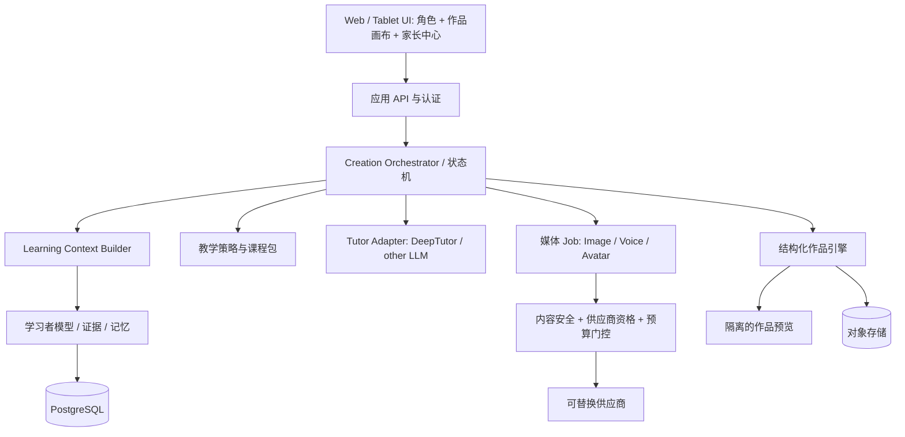

# 系统架构

## 当前运行形态

`静态网页 → 本地项目状态机 → 本地证据日志 → 技能聚合/推荐 → localStorage`

网页通过 GitHub Pages 或本地 Node HTTP 服务运行。没有在线 API、数据库、真实模型或账号。零第三方脚本，CSP 限制同源连接，不采集设备权限。此边界使孩子可以立即在家长陪同下体验，但不等于生产安全系统。

## 目标架构：模块化单体先行

## 责任划分

- **前端**：显示推荐理由的儿童友好版本、采集显式操作、可回滚局部编辑；不是业务事实来源。
- **Orchestrator**：唯一推进创作阶段者。负责授权、状态版本、幂等、任务取消和预算；不能由自由聊天越过门槛。
- **Context Builder**：从当前 child 范围选择相关经历/技能/偏好，生成可审计快照。不检索其他孩子，不倾倒全量聊天。
- **Learner Model**：证据事实与技能估计分离；支持撤回、过期与重算。不是任意 LLM 读写的文本备忘录。
- **Teaching Policy**：决定目标、提示、变式和不确定时的验证任务；每个决定要有依据和停止条件。
- **Tutor Adapter**：把结构化 TeachingPlan 转成一轮一个问题的语言；可请求受限工具，不独自改技能或发布作品。
- **Project Engine**：校验 SceneGraph/patch，管理版本；角色说“我改好了”不等于实际改好。
- **Media Gateway**：生图/语音/Vivix 独立接入；预算预占，幂等提交，回调验证，取消后不展示迟到结果。

## 技术演进

试用原生 ESM 是有意的零依赖原型选择，不是宣布改用全套新生产技术。领域模块（memory/projects/catalog）可移入 TypeScript 包；需要账号和 SSR 时使用 Next.js，后端用 FastAPI。PostgreSQL + 对象存储足够作为起点；队列在异步媒体任务出现后加入。不要先建十个微服务、图数据库或向量数据库。

DeepTutor 接入前锁定版本、核查 SDK/API 与许可、编写适配器契约测试。不让其“Visualize 一次出全页”的默认体验直接暴露给孩子。不假设内部 API 在未来版本保持稳定。

## 关键协议

`LearningEvent → validate → dedupe → persist → derive skill state → build context → plan → approve actions → apply patch → observe result`

教学计划包含 context_version；作品操作包含 expected_project_version；异步媒体结果包含 job_id/request_id/content_hash。过期或取消的回复不更新当前作品。后台任务不能把供应商返回的可执行 HTML/SVG 直接注入主应用。

## 角色模式与成本

- Canvas：角色低干扰，画布可独立使用。
- Voice：真实语音引导（后续），轻量本地形象；儿童音频须独立授权和供应商核查。
- Live：短时 Vivix/同类，按预算启用。只隐藏视频不等于关闭计费会话；服务端显式 close、确认终态并对账。

不预设 Vivix 国际 API 可以服务大陆未成年人。支持模式要由 `ProviderCapability + jurisdiction + age + consent + budget` 联合决定，而不是前端开关。

## 安全边界

家庭认证与 child 授权必须在服务端；API Key 永不进入浏览器。生成代码在独立 origin/沙箱执行，禁止访问主站 cookies、localStorage、内网与凭据。默认不允许任意网络与外链；危险能力需要最小白名单，儿童操作不能确认支付/上传敏感数据。

当前试用不执行模型生成代码，不加载外部图片 URL；保存的 SVG 是程序绘制并转义文本。未来外部 SVG 必须转安全格式或严格净化，不能复用“本地 SVG 可直接插入”的信任假设。

## 观察与回滚

日志默认只含匿名 request/tenant 关联标识、规则版本、token/分钟/张数、延迟与错误码；不默认记录儿童原始内容。监控质量失败、串记忆、错误引用已删除证据、成本超额。模型、规则、课程包均可回滚；旧证据保留原 rubricVersion。
